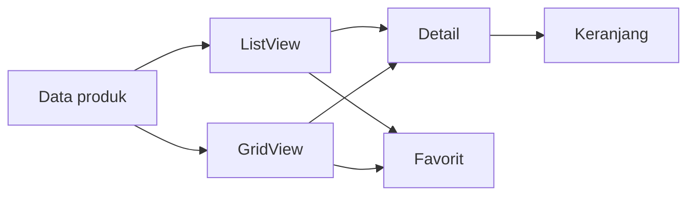

# flutter_widget

Aplikasi praktikum Flutter untuk kartu mahasiswa dan katalog perlengkapan kuliah. Beranda, Kartu, Profil, Galeri, Kontak, dan Katalog dapat dibuka dari navigasi bawah di ponsel atau navigasi samping pada layar lebar.

### Alur katalog



Data contoh berada di `lib/data/produk.dart`. List dan Grid mengirim produk terpilih ke halaman detail melalui `Navigator.push`. Favorit dan jumlah produk dalam keranjang disimpan selama aplikasi berjalan. Foto produk dimuat dari internet.

### Menjalankan proyek

```sh
flutter pub get
flutter run
```

Gunakan `flutter analyze` untuk memeriksa kode dan `flutter test` untuk menguji navigasi, tata letak, favorit, dan keranjang.
